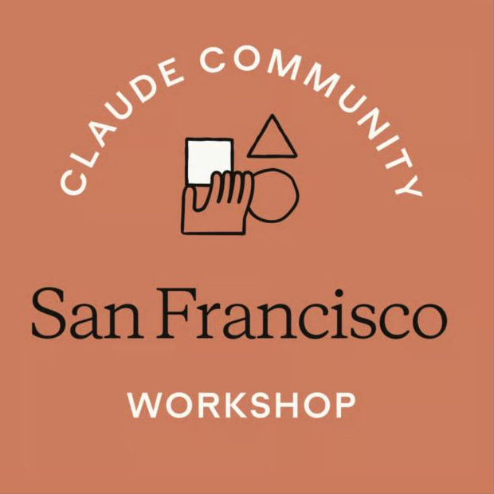
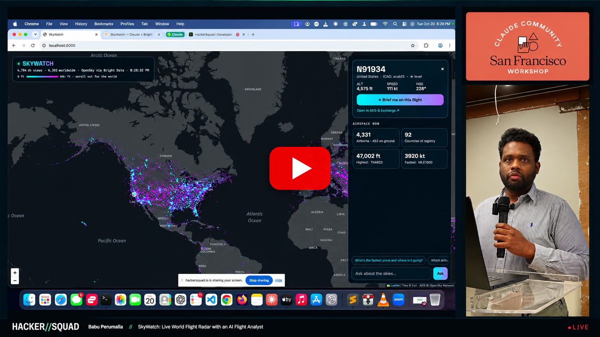
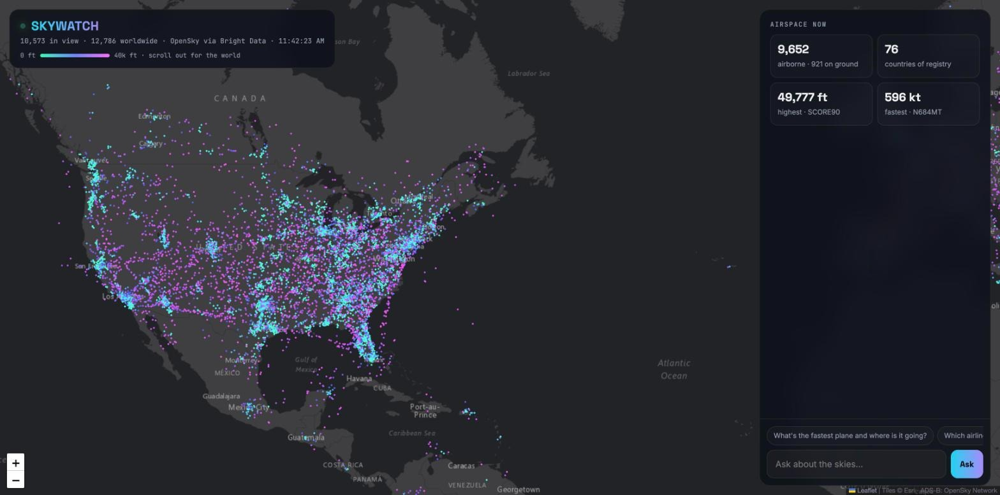
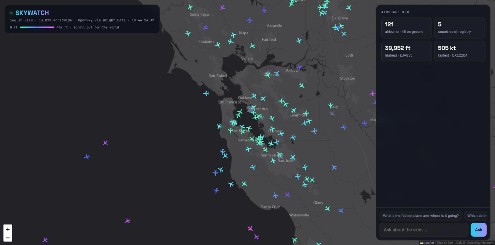
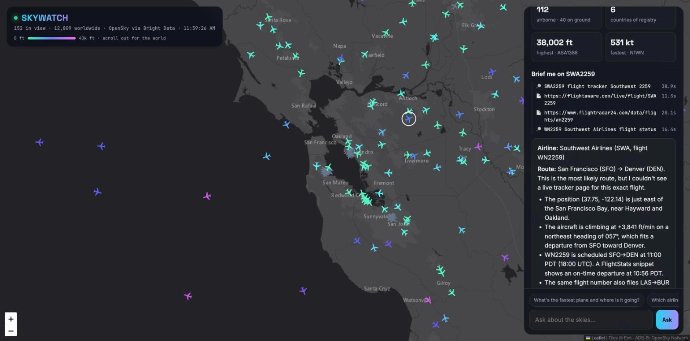
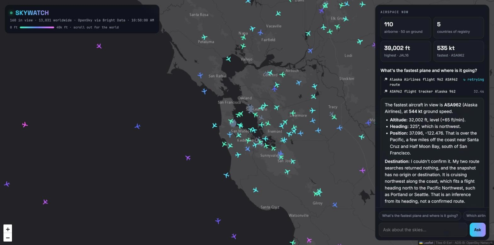

# ✈️ SkyWatch

**A live world flight radar with an AI flight analyst. Built with Claude + Bright Data.**

Every dot on the map is a real aircraft in the air right now. Click any plane and an AI agent researches it on the live web, returning the airline, route, aircraft type and status, with sources.

Built at [San Francisco | Claude Code Build Night: Research with Web Data](https://luma.com/claude-9gt7), October 20, 2026.

<a href="https://luma.com/claude-9gt7"></a>

<sub>Built at <a href="https://luma.com/claude-9gt7">San Francisco | Claude Code Build Night: Research with Web Data</a> (Oct 20, 2026)</sub>

▶️ **[Watch the live demo](https://www.youtube.com/watch?v=rLcXh3crHt8)** · 📑 [Demo slides (PDF)](docs/SkyWatch-Demo.pdf) · 🏁 [HackerSquad project page](https://hackersquad.io/events/san-francisco-claude-code-build-night-research-with-web-data/projects/cmvhjow69004lpg239x6ec3z4)

[](https://www.youtube.com/watch?v=rLcXh3crHt8)

---

## Screenshots

**Live world map:** every airborne plane over the Americas, colored by altitude.



**Zoomed into the Bay Area:** plane icons gliding between updates, with live airspace stats.



**Brief me:** Claude researches a clicked flight on the live web, shows each search and page read, and says plainly what it can't confirm.



**Ask the skies:** questions about the traffic on screen, answered from the live snapshot plus the web.



## Features

| | |
|---|---|
| 🌍 **Live world map** | 10,000+ aircraft from live ADS-B data, colored by altitude. Glowing dots when zoomed out, rotated plane icons when zoomed in. |
| 🛫 **Continuous motion** | Planes glide smoothly between updates. Each one is dead-reckoned from its real speed and heading, then eased onto fresh positions. |
| 🔎 **Brief me** | Click a plane: Claude searches and reads the live web through Bright Data and returns airline, route, aircraft, status and a fun fact, with sources. |
| 💬 **Ask the skies** | Ask questions about the traffic on screen ("What's the fastest plane and where is it going?"). Claude answers from the live snapshot and uses the web when needed. |
| 📡 **Live agent trace** | Every search and page read streams to the UI as it happens, so you can watch the agent work. |
| ⚡ **Instant startup** | A preloaded world snapshot means the map appears immediately. Live data refreshes in the background. |

## How it works

```
 Clicked plane / question
          │
          ▼
 ┌──────────────────┐   web_search   ┌──────────────────────────┐
 │  Claude (agent)  │ ─────────────▶ │ Bright Data SERP API     │  live Google search
 │  plans, picks    │                └──────────────────────────┘
 │  tools, reasons  │   fetch_page   ┌──────────────────────────┐
 │                  │ ─────────────▶ │ Bright Data Web Unlocker │  reads tracker/airline
 └──────────────────┘                └──────────────────────────┘  sites past bot blocks
          │
          ▼
 Cited briefing, streamed to the browser
```

- **Claude is the brain.** It runs a multi-step tool-use loop, decides what to search and which pages to read, runs independent calls in parallel, and says plainly when it can't confirm something.
- **Bright Data is the eyes.** The SERP API gives Claude live Google search; Web Unlocker reads flight-tracker and airline pages that block bots, need JavaScript or show CAPTCHAs. It also fetches the worldwide ADS-B feed.
- **Flight positions** come from the [OpenSky Network](https://opensky-network.org) public ADS-B feed.

### Performance design

- **Canvas rendering:** all aircraft are drawn on one canvas (not one DOM element each), so 10k+ planes stay smooth.
- **Preload + cache:** `preload.py` saves a worldwide snapshot to `world_cache.json`; the server boots from it instantly.
- **Background refresh:** the server re-fetches the world every 30 s in a background thread and rewrites the cache, so requests never wait on the network.
- **In-memory filtering:** panning and zooming are served from memory for whatever area is on screen.

## Tech stack

- **Backend:** Python 3 standard-library HTTP server, `anthropic` SDK, `requests`
- **Frontend:** single `index.html`, Leaflet + Canvas 2D, Esri dark basemap, streaming NDJSON
- **AI:** Claude via the Messages API with tool use
- **Data:** Bright Data SERP API + Web Unlocker, OpenSky Network ADS-B

## Getting started

### Prerequisites

- Python 3.9+
- An [Anthropic API key](https://console.anthropic.com)
- A [Bright Data](https://brightdata.com) account with two zones: a **SERP API** zone and a **Web Unlocker** zone (Dashboard → Web Access → Create API)

### Run

1. Install dependencies:
   ```bash
   pip3 install anthropic requests
   ```
2. Set your keys (see `.env.example`):
   ```bash
   export ANTHROPIC_API_KEY=sk-ant-...
   export BRIGHTDATA_API_TOKEN=your-brightdata-api-key
   export BRIGHTDATA_SERP_ZONE=serp_api1          # optional if named serp_api1
   export BRIGHTDATA_UNLOCKER_ZONE=web_unlocker1  # optional if named web_unlocker1
   ```
3. Cache the worldwide snapshot (about 30–60 s):
   ```bash
   python3 preload.py
   ```
4. Start the server and open http://localhost:8000:
   ```bash
   python3 app.py
   ```

### Options

| Variable | Default | Purpose |
|---|---|---|
| `CLAUDE_MODEL` | `claude-sonnet-5-5` | Claude model used by the agent |
| `WORLD_TTL` | `30` | Seconds between worldwide refreshes |
| `PORT` | `8000` | Server port |
| `DEMO` | unset | `DEMO=1` uses simulated Bay Area traffic (offline backup) |

## Project structure

```
skywatch/
├── app.py          # server: flight feed + cache, Claude agent loop, Bright Data tools
├── preload.py      # fetches the world snapshot into world_cache.json
├── index.html      # map, canvas plane layer, briefing + chat UI
├── .env.example    # which keys to set (placeholders only)
└── README.md
```

## Notes

- **Never commit keys.** They are read from environment variables only; `world_cache.json` and `.env` files are git-ignored.
- **Be a good citizen of OpenSky.** Its free API is for non-commercial use and is rate-limited. For anything beyond a demo, register a free OpenSky account and use authenticated requests.
- **Briefings take time.** Answers that need web lookups usually take 30–60 s; questions answerable from the on-screen snapshot are near-instant.

## Roadmap

- Route lines on the map by auto-enriching every plane
- Track a single flight with delay and diversion alerts
- Live airport delay and weather summaries

## Credits

Built by [Babu Sovereign Perumalla](https://github.com/babusovereign) with Claude. Flight data © [OpenSky Network](https://opensky-network.org); basemap © Esri.

## License

Copyright 2026 Babu Sovereign Perumalla. Licensed under the [Apache License 2.0](LICENSE). If you reuse or redistribute this code, keep the [NOTICE](NOTICE) file with it.

The license covers this project's code only. OpenSky Network flight data and Esri basemap tiles are subject to their providers' own terms.
